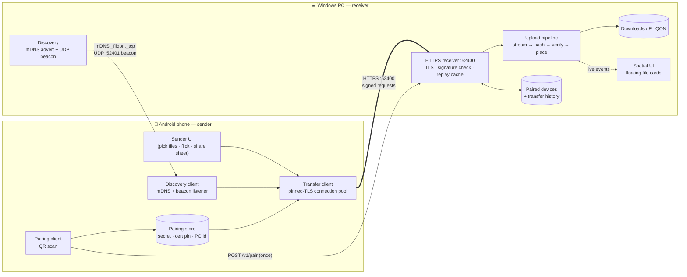
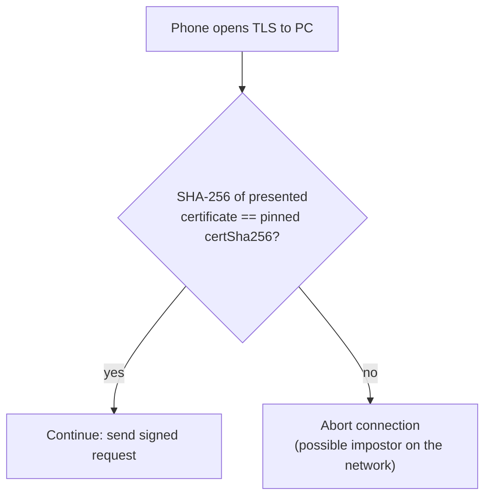
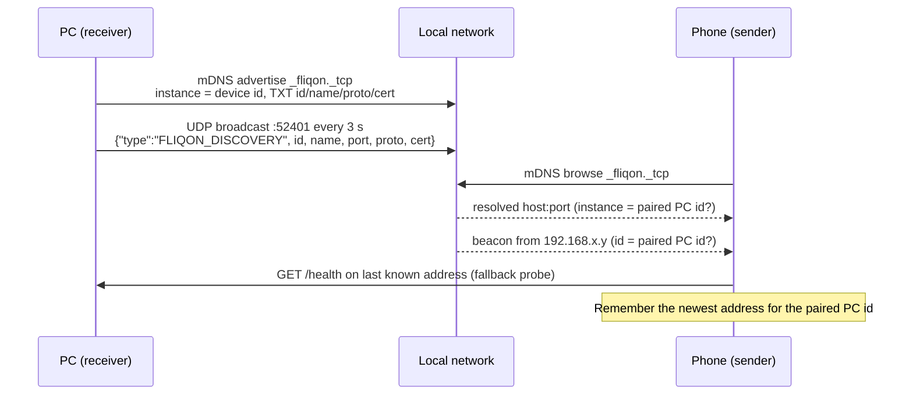
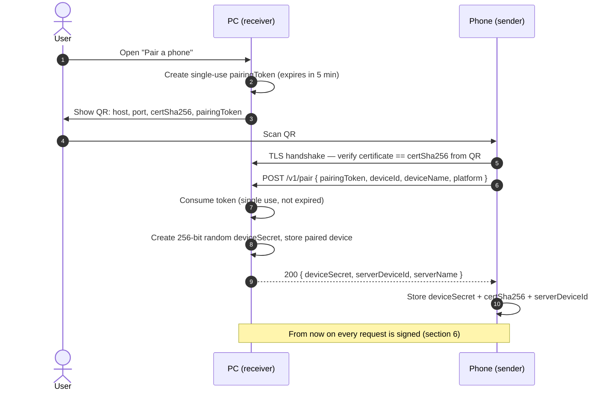
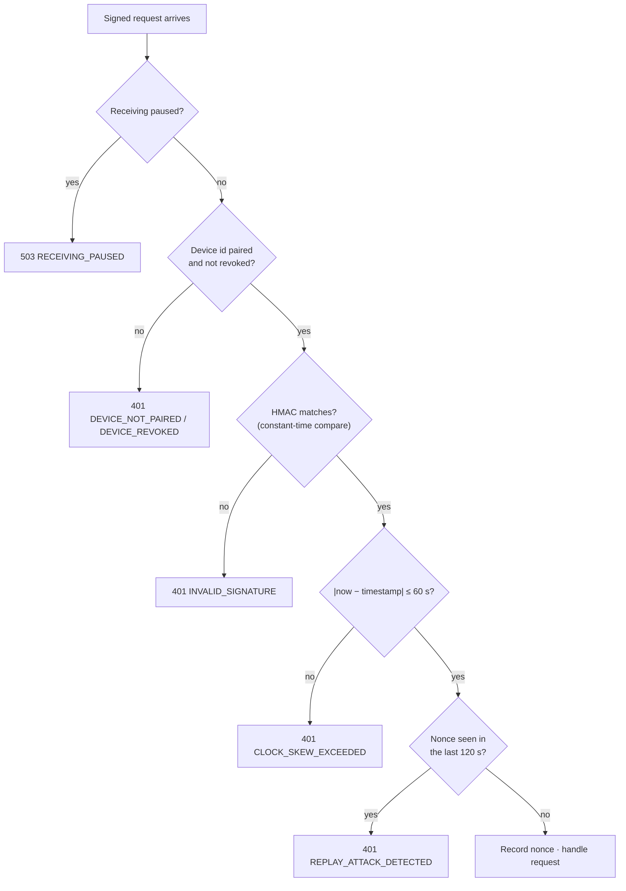
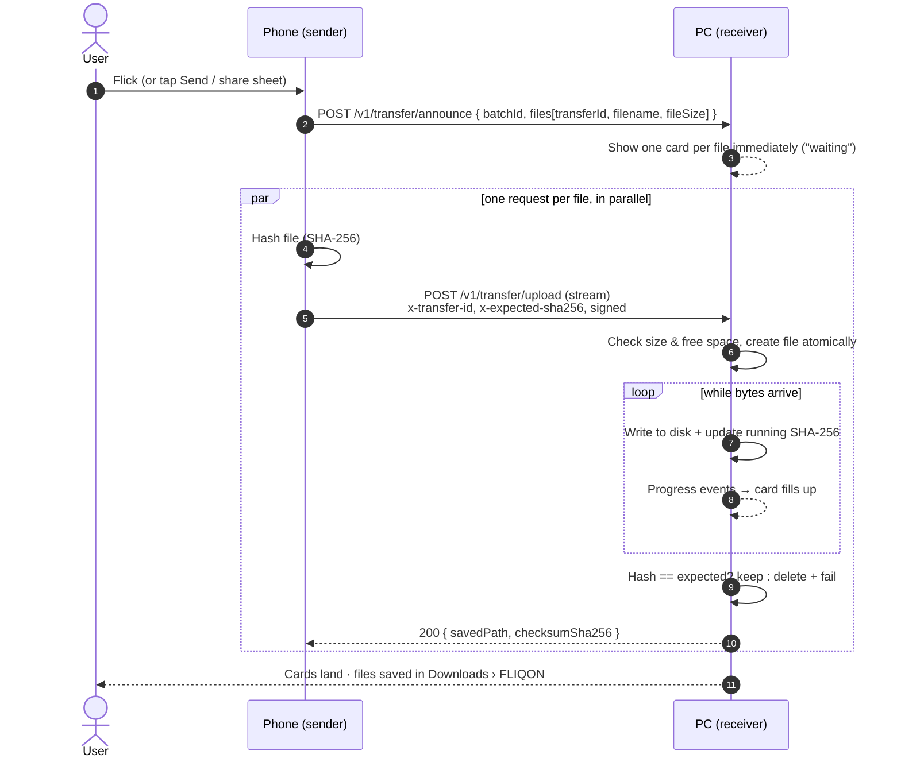
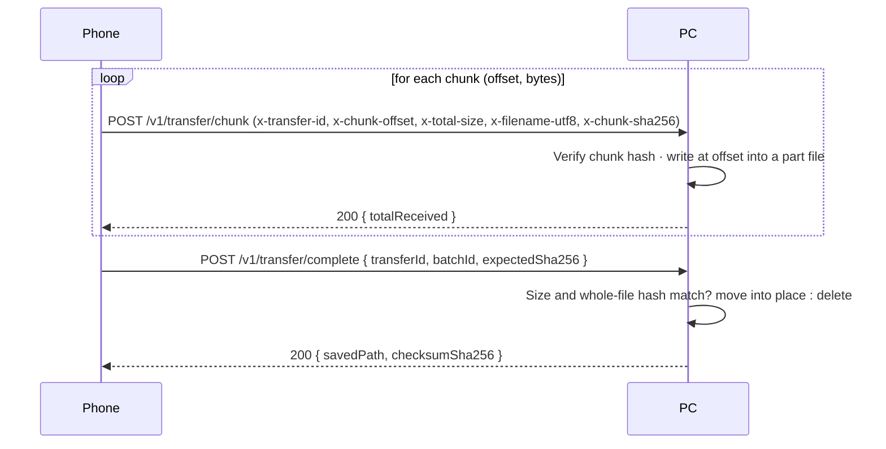
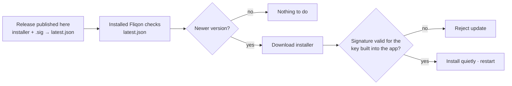

# The Fliqon Protocol

**Version 1.1** · Licence: [CC BY 4.0](LICENSE) (this document only)

Fliqon moves files from an Android phone (the **sender**) to a Windows PC (the **receiver**) directly over
the local network. This document explains how the two devices find each other, establish trust once, prove
every request is genuine, and move files so that what lands on the PC is exactly what left the phone.

It describes the *wire protocol* — what travels between devices. How the apps implement it (the spatial
interface, flick detection, physics, design) is proprietary and not covered here.

- [1. Design goals](#1-design-goals)
- [2. Architecture](#2-architecture)
- [3. Identity and transport security](#3-identity-and-transport-security)
- [4. Discovery](#4-discovery)
- [5. Pairing](#5-pairing)
- [6. Request authentication](#6-request-authentication)
- [7. Transferring files](#7-transferring-files)
- [8. Endpoint reference](#8-endpoint-reference)
- [9. Receiver safety requirements](#9-receiver-safety-requirements)
- [10. Errors](#10-errors)
- [11. Security properties](#11-security-properties)
- [12. Software updates](#12-software-updates)
- [13. Versioning](#13-versioning)

---

## 1. Design goals

| Goal | How the protocol achieves it |
|:--|:--|
| **Local only** | Phone and PC talk directly on the LAN (or a hotspot). No server ever sees a file. |
| **Trust once, then automatic** | One QR scan pins the PC's certificate and gives the phone a per-device secret. |
| **Every request is genuine** | Each request is signed with that secret and can't be replayed. |
| **Exact delivery** | Every file is SHA-256 verified before it's accepted; partial or altered files are discarded. |
| **Instant feedback** | The phone announces a batch the moment the user flicks, before any bytes move. |
| **Fast** | Files stream in parallel over reused TLS connections, hashed in a single pass. |
| **Resilient** | Discovery survives IP changes; multicast-hostile networks are handled by a UDP beacon. |

## 2. Architecture



| Port | Protocol | Direction | Purpose |
|:--|:--|:--|:--|
| **52400** | TCP / HTTPS (TLS 1.2+) | phone → PC | All API traffic: pairing, info, announce, uploads |
| **52401** | UDP broadcast | PC → LAN | Discovery beacon every 3 s |
| **5353** | UDP multicast (mDNS) | both | `_fliqon._tcp` service discovery |

The PC is a **server only**: it never initiates connections to the phone. The phone is a **client only**.

## 3. Identity and transport security

### 3.1 The PC's identity

On first launch the receiver creates two things and keeps them for as long as it's installed:

- a **device id**, e.g. `fliqon-win-c0889fb66353`, used in discovery and pairing responses;
- a **self-signed X.509 certificate** with an **ECDSA P-256** key, `CN=FLIQON-Desktop-<device id>`.

The certificate is identified by its fingerprint:

```
certSha256 = lowercase hex( SHA-256( DER(certificate) ) )        # 64 hex characters
```

### 3.2 Certificate pinning instead of certificate authorities

A LAN device can't get a publicly trusted certificate, so Fliqon uses **pinning**: the phone learns the exact
fingerprint during pairing (from the QR code, which the user scans off the PC's own screen) and from then on
**accepts only that certificate**. Hostname checks are unnecessary because the certificate itself is pinned;
IP addresses can change freely.



All traffic is HTTPS; the sender must not use cleartext HTTP.

## 4. Discovery

The phone needs the PC's *current* IP address. DHCP can change it at any time, and many routers and hotspots
block multicast, so the protocol layers three mechanisms. The phone uses whichever answers first.



| Mechanism | What it carries | Notes |
|:--|:--|:--|
| **mDNS / DNS-SD** | Service `_fliqon._tcp.local.`, instance name = device id, port 52400. TXT: `id`, `name`, `proto=1`, `cert` (first 16 hex chars of `certSha256`). | Standard, works on most home Wi-Fi. |
| **UDP beacon** | Broadcast to `255.255.255.255:52401` and each private interface's `/24` broadcast address, every 3 s: `{"type":"FLIQON_DISCOVERY","id":"…","name":"…","port":52400,"proto":1,"cert":"<16 hex>"}` | Survives networks that drop multicast. The sender IP *is* the PC's address. |
| **Probe** | `GET https://<last-known-host>:52400/health` | Fast path when nothing changed. |
| **Manual** | User types the PC's IP | Last resort (shown in the PC's interface). |

The `cert` prefix lets the phone ignore beacons from other Fliqon PCs; the full pin is still enforced on
connect. A phone only *uses* an address for the PC id it paired with.

## 5. Pairing

Pairing happens once per phone and turns "a QR code on screen" into a long-lived, mutually known secret.



**Why it's safe:** the QR is only visible on the PC's own screen (physical presence), the token is single-use
and short-lived, and the phone verifies the certificate *before* sending anything — so an attacker on the
network can neither impersonate the PC nor reuse a token.

### 5.1 QR code payload

```json
{
  "v": 1,
  "name": "LAPTOP-85C0AB8P",
  "host": "192.168.0.101",
  "port": 52400,
  "certSha256": "4a7f1b2c3d4e5f60718293a4b5c6d7e8f90123456789abcdef0123456789abcd",
  "pairingToken": "ptk_8f90b2c14a7e4d0b9a1c2e3f4a5b6c7d",
  "expiresAt": 1794738500
}
```

`expiresAt` is a Unix timestamp (seconds). Showing a new QR invalidates the previous token.

### 5.2 `POST /v1/pair`

Unauthenticated (the token *is* the authentication). Request:

```json
{ "pairingToken": "ptk_…", "deviceId": "fliqon-android-d211e683", "deviceName": "Samsung SM-A156E", "platform": "android" }
```

Response `200`:

```json
{ "status": "paired", "deviceSecret": "<64 hex chars>", "serverDeviceId": "fliqon-win-c0889fb66353", "serverName": "LAPTOP-85C0AB8P" }
```

Pairing a phone that is already paired replaces its secret (re-pairing is how a phone recovers). Errors:
`400` invalid identity fields, `401` invalid or expired token.

## 6. Request authentication

Every request after pairing (except `/health`) proves two things: *which paired phone* sent it, and that *this
exact request* — method, path, body — was produced by someone holding that phone's secret, recently, once.

### 6.1 Headers

| Header | Value |
|:--|:--|
| `X-Fliqon-Device-Id` | The phone's `deviceId` from pairing |
| `X-Fliqon-Timestamp` | Unix time in seconds |
| `X-Fliqon-Nonce` | A fresh random value per request (UUID v4) |
| `X-Fliqon-Signature` | Lowercase hex HMAC-SHA256 (below) |

### 6.2 Signature

```
canonical = METHOD + "\n" + PATH + "\n" + TIMESTAMP + "\n" + NONCE + "\n" + BODY_SHA256
signature = hex( HMAC-SHA256( key = UTF-8 bytes of the 64-hex deviceSecret, canonical ) )
```

`BODY_SHA256` is the lowercase hex SHA-256 of what the request carries:

| Request | `BODY_SHA256` |
|:--|:--|
| `GET /v1/info` | SHA-256 of the empty string: `e3b0c44298fc1c149afbf4c8996fb92427ae41e4649b934ca495991b7852b855` |
| `POST /v1/transfer/upload` | SHA-256 of the **whole file** (equal to `x-expected-sha256`) |
| `POST /v1/transfer/chunk` | SHA-256 of the **chunk bytes** |
| `POST /v1/transfer/announce`, `/complete`, `/v1/device/revoke` | SHA-256 of the **raw JSON body** |

Binding the body hash into the signature means a file can't be swapped in transit even by someone who could
somehow read the traffic. For streamed uploads the whole-file hash is signed up front and enforced when the
stream ends. (Receivers also accept the hex-decoded 32-byte form of the key, used by early builds.)

### 6.3 How the receiver verifies



The signature is checked **before** the nonce is recorded, so unauthenticated traffic can't fill the replay
cache. Phone and PC clocks must agree within ±60 seconds (automatic network time is enough).

## 7. Transferring files

### 7.1 A flick, end to end



1. **Announce (best effort).** Sent first so the receiver can show the whole batch instantly. Uploads never
   wait for it; if it's lost, cards appear when uploads start.
2. **Upload.** Each file is one streamed request. The sender hashes the file first (needed for the signature),
   then streams it; the receiver writes and hashes in a single pass.
3. **Verify and place.** The file is created atomically in the destination folder under a sanitized,
   non-colliding name (`report.pdf`, `report (1).pdf`, …). A hash mismatch deletes the file.

Files in a batch upload **in parallel** over a pool of reused TLS connections, so a 20-photo flick costs one
handshake, not twenty.

### 7.2 Upload headers

| Header | Required | Meaning |
|:--|:--|:--|
| `x-transfer-id` | recommended | Matches the announced id; `[A-Za-z0-9_-]`, ≤ 64 chars |
| `x-batch-id` | recommended | Groups the files of one flick |
| `x-filename-utf8` | recommended | Percent-encoded UTF-8 filename (lossless: Hindi, emoji, …) |
| `x-filename` | fallback | ASCII-only filename for older receivers |
| `x-file-size` | recommended | Total bytes; used for the free-space check and progress |
| `x-expected-sha256` | **yes** | Whole-file SHA-256; also the signed `BODY_SHA256` |

### 7.3 Resumable chunked upload (compatibility)

Older senders split large files into chunks. Receivers keep supporting it:



Chunks must stay within `x-total-size`; a transfer belongs to the device that started it; abandoned part
files are removed after 30 minutes of inactivity.

## 8. Endpoint reference

| Method & path | Auth | Body | Success response |
|:--|:--|:--|:--|
| `GET /health` | none | — | `{"status":"ok","service":"fliqon","protocolVersion":1}` |
| `POST /v1/pair` | pairing token | JSON (5.2) | `{status, deviceSecret, serverDeviceId, serverName}` |
| `GET /v1/info` | signed | — | `{name, deviceId, appVersion, protocolVersion, maxFileSize, freeSpaceBytes}` |
| `POST /v1/transfer/announce` | signed | `{batchId, trigger?, files:[{transferId, filename, fileSize}]}` (≤ 500 files) | `{success, accepted}` |
| `POST /v1/transfer/upload` | signed | raw file stream | `{success, transferId, batchId, filename, fileSize, checksumSha256, savedPath}` |
| `POST /v1/transfer/chunk` | signed | raw chunk (≤ 64 MB) | `{success, transferId, bytesReceived, totalReceived}` |
| `POST /v1/transfer/complete` | signed | `{transferId, batchId?, expectedSha256}` | same as upload |
| `POST /v1/device/revoke` | signed | `{deviceId}` — must be the caller's own id | `{status:"revoked", deviceId}` |

Limits: files up to **16 GB** (`maxFileSize` in `/v1/info`); free space must exceed **1.2 ×** the file size.

## 9. Receiver safety requirements

A conforming receiver MUST:

- treat every filename as untrusted: strip path separators, `..` sequences, control characters and characters
  illegal on the target filesystem, and refuse reserved device names (`CON`, `NUL`, `COM1`, …);
- write files only inside its configured destination folder, creating them atomically and never overwriting an
  existing file;
- verify the SHA-256 of every completed file against the signed expected hash and delete mismatches;
- accept `transferId` / `batchId` values only from `[A-Za-z0-9_-]`, at most 64 characters;
- never serve stored files or any other data to unauthenticated clients.

## 10. Errors

Errors are JSON: `{"error": "<CODE or message>"}`.

| Status | Codes |
|:--|:--|
| `400` | `MISSING_EXPECTED_SHA256`, `CHECKSUM_MISMATCH`, `CHUNK_CHECKSUM_MISMATCH`, `CHUNK_OUT_OF_RANGE`, `INVALID_TRANSFER_ID`, `INVALID_JSON`, `INVALID_TIMESTAMP`, `STREAM_INTERRUPTED`, `INCOMPLETE_UPLOAD` |
| `401` | `MISSING_*`, `DEVICE_NOT_PAIRED`, `DEVICE_REVOKED`, `INVALID_SIGNATURE`, `CLOCK_SKEW_EXCEEDED`, `REPLAY_ATTACK_DETECTED`, invalid pairing token |
| `403` | `TRANSFER_OWNED_BY_OTHER_DEVICE`, `CAN_ONLY_REVOKE_SELF` |
| `404` | `UNKNOWN_TRANSFER`, `PART_FILE_MISSING` |
| `413` | `MAX_FILE_SIZE_EXCEEDED`, `SIZE_EXCEEDED` |
| `503` | `RECEIVING_PAUSED` |
| `507` | `INSUFFICIENT_STORAGE` |

Senders should retry network failures and `5xx` responses with back-off, and not retry `4xx`.

## 11. Security properties

| Threat | Defence |
|:--|:--|
| Someone on the same Wi-Fi impersonates the PC | Certificate pinning: the phone only talks to the certificate it saw in the QR code |
| Someone on the Wi-Fi sends files to the PC | Every request needs a valid HMAC from a paired phone's secret |
| A captured request is sent again | Single-use nonce + ±60 s timestamp window |
| A file is altered or truncated in transit | Signed whole-file SHA-256, verified before the file is kept |
| A crafted filename escapes the download folder | Strict sanitizing + atomic creation inside the folder |
| A guessed or old pairing code | Tokens are random, single-use and expire after 5 minutes |
| A lost or stolen phone | The PC can revoke it; revoked phones are rejected immediately |
| Reading received files over the network | No endpoint serves stored files |

**Out of scope:** an attacker who controls the PC or an unlocked paired phone; denial of service on the LAN.

## 12. Software updates

Not part of the device-to-device protocol, but part of the trust story. Installed Windows apps poll
`latest.json` from the [latest release](https://github.com/UshnishG/fliqon-releases/releases/latest) of this
repository and install an update **only if its signature verifies** against a public key built into the app.



Android installs check the latest release here and offer the new APK; Android itself only allows the update
if it's signed with the same key as the installed app.

## 13. Versioning

- `protocolVersion` (in `/health`, `/v1/info`, discovery `proto`) is **1**. Version 1.1 added the per-route
  body hash, `announce`, `x-filename-utf8` and the UDP beacon, all backwards compatible.
- Receivers must keep accepting senders from the same major version; unknown headers and JSON fields are
  ignored.

---

© 2026 Ushnish Ghosal. This specification is licensed under the
[Creative Commons Attribution 4.0 International licence (CC BY 4.0)](https://creativecommons.org/licenses/by/4.0/):
you may share and adapt it — including to build compatible implementations — with attribution. It does not
cover the Fliqon applications, which are proprietary.
