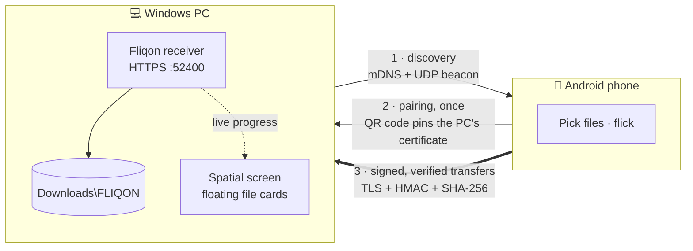

# Fliqon

**Flick files from your Android phone to your Windows PC.** Pick files, flick the phone — they float onto
your screen a moment later. Directly over your local network: no cloud, no cables, no account.

This repository is Fliqon's public home. It holds:

| | |
|:--|:--|
| 📦 **[Releases](https://github.com/UshnishG/fliqon-releases/releases)** | Official, signed builds for Windows and Android. Installed apps update themselves from here. |
| 📘 **[PROTOCOL.md](PROTOCOL.md)** | The open Fliqon protocol: discovery, pairing, request signing and file transfer, with diagrams. |

> [!NOTE]
> Fliqon is in **private beta**. Join the Early Access Programme at **https://fliqon.vercel.app/beta** —
> approved testers get a personal page with installation steps.

## Downloads

Each [release](https://github.com/UshnishG/fliqon-releases/releases/latest) contains:

| File | For |
|:--|:--|
| `FLIQON-Setup-x64.exe` | Windows 10 / 11 (64-bit) |
| `FLIQON-android.apk` | Android 8.0 or newer |
| `SHA256SUMS.txt` | Checksums for verifying downloads |
| `latest.json` | Signed update manifest read by the Windows app |

**Verify a download** (optional):

```powershell
# Windows PowerShell — compare with the line in SHA256SUMS.txt
Get-FileHash .\FLIQON-Setup-x64.exe -Algorithm SHA256
```

```bash
# macOS / Linux
sha256sum -c SHA256SUMS.txt --ignore-missing
```

## How it works



1. **Find** — the PC announces itself on your network; the phone remembers its address even when it changes.
2. **Pair once** — scan a QR code on the PC. The phone learns the PC's exact certificate and receives a secret
   only those two devices know.
3. **Send** — every request is encrypted, signed and replay-proof; every file is checked with SHA-256 before
   it's kept. Files go straight to `Downloads\FLIQON`.

Nothing passes through a server. The full mechanism, every endpoint and the security model are in
**[PROTOCOL.md](PROTOCOL.md)**.

## Updates

- **Windows** checks this repository's latest release and installs updates only if their signature matches the
  key built into the app.
- **Android** checks for new releases and offers the new APK; Android installs it only if it's signed with the
  same key as the installed app.

## Feedback and support

Use **Feedback** inside either app (rate, report a bug, see what's new), or the website:
**https://fliqon.vercel.app**.

## Licence

- **[PROTOCOL.md](PROTOCOL.md)** is licensed under [CC BY 4.0](https://creativecommons.org/licenses/by/4.0/) —
  you're welcome to build compatible implementations.
- **The Fliqon applications** (the files attached to releases) are proprietary software © 2026 Ushnish Ghosal.
  All rights reserved. Use is subject to the [Terms](https://fliqon.vercel.app/terms) and, during the beta,
  the [Beta Testing Agreement](https://fliqon.vercel.app/beta-agreement).

See [LICENSE](LICENSE).
